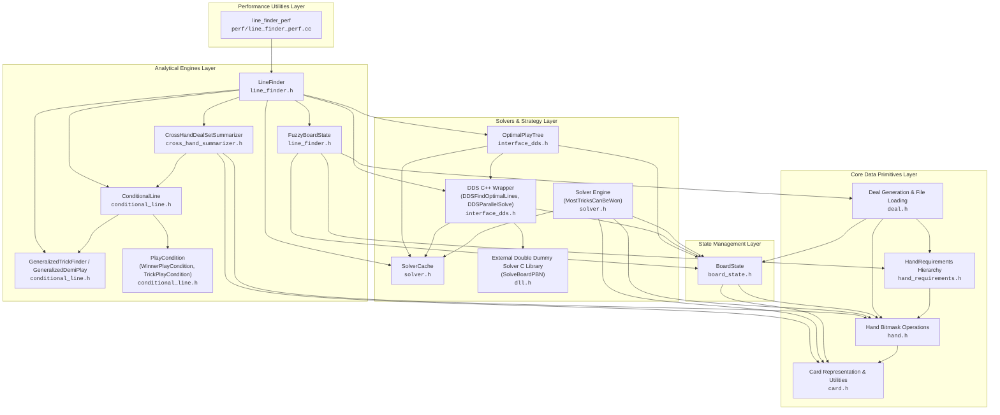
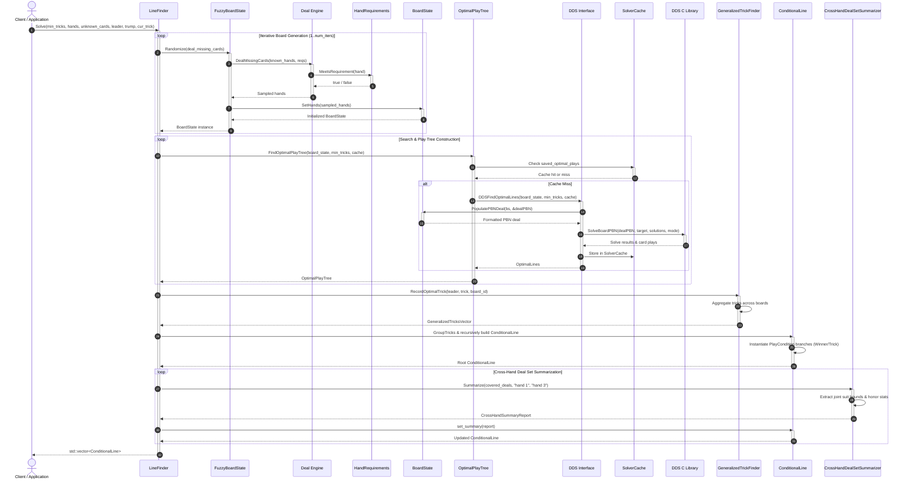

# Bridge Solver & Line Finder Architecture Specification

This document details the software architecture, component topology, runtime data flow, and module interfaces for the **Bridge Solver & Line Finder** C++ library.

---

## 1. Top-Level Component Topology

The system is organized into four distinct architectural layers, ranging from core data primitives up to high-level analytical line-finding engines. The component topology diagram below highlights module boundaries, header dependencies, and call-graph relationships across the library.

---

## 2. Line-Finding Evaluation Sequence Diagram

The runtime execution flow during line-finding searches involves stochastic deal sampling, requirement validation, Double Dummy Solver (DDS) invocation, play tree construction, and decision tree synthesis.

---

## 3. Module Overview Tables

The system modules are categorized below by their primary architectural layer, header file location, responsibility, and public interface routines.

### 3.1 Analytical Engines Layer

| Module Name | Header File | Architectural Responsibility | Key Public Interface Routines |
| :--- | :--- | :--- | :--- |
| **LineFinder** | `line_finder.h` | High-level search engine for discovering optimal probabilistic lines of play and opening leads across randomized deals. | - `Solve()`: Evaluates and generates conditional lines of play. - `FindBestLead()`: Identifies candidate opening leads. - `FindTricksWon()`: Computes trick distribution statistics. |
| **FuzzyBoardState** | `line_finder.h` | Represents partially specified bridge deals with unknown card locations and hand shape/hcp constraints. | - `SetHands()`: Sets known hand holdings. - `SetRequirements()`: Applies hand constraints. - `Randomize()`: Generates concrete deal instances. |
| **ConditionalLine** | `conditional_line.h` | Decision tree structure representing branching lines of play conditioned on opponent actions or trick outcomes. | - `AddCondition()`: Adds a conditional branch. - `SetAction()`: Sets the initial generalized trick action. - `Describe()`: Generates human-readable line output. |
| **GeneralizedTrickFinder & DemiPlay** | `conditional_line.h` | Aggregates and simplifies specific card plays into generalized suit/rank trick structures across board samples. | - `RecordOptimalTrick()`: Records trick results. - `GetGeneralizedTricks()`: Extracts top generalized tricks. - `GroupTricks()`: Groups compatible tricks. |
| **PlayCondition** | `conditional_line.h` | Base class and implementations (`WinnerPlayCondition`, `TrickPlayCondition`) for evaluating decision tree branch conditions. | - `Describe()`: Formats condition description string. |
| **CrossHandDealSetSummarizer** | `cross_hand_summarizer.h` | Analyzes sets of paired deals across covered board states to compute joint suit distribution bounds and honor card possession statistics. | - `Summarize()`: Generates `CrossHandSummaryReport` for paired deal sets. - `JointSuitRuleExtractor`: Extracts suit length bounds across deals. - `HonorPossessionClassifier`: Computes honor card distribution statistics. |

### 3.2 Solvers & Strategy Layer

| Module Name | Header File | Architectural Responsibility | Key Public Interface Routines |
| :--- | :--- | :--- | :--- |
| **OptimalPlayTree** | `interface_dds.h` | Recursive game tree representation of optimal double-dummy card plays and trick continuations. | - `FindOptimalPlayTree()`: Factory method to construct play tree. - `Deepen()`: Expands tree depth. - `PlayTrick()`: Advances tree state. |
| **DDS C++ Interface** | `interface_dds.h` | Higher-level bridge solver interface wrapping low-level C-DDS calls, parallel solving, and PBN conversion. | - `DDSFindOptimalLines()`: Finds winning lines for target tricks. - `DDSParallelSolve()`: Batch solves multiple board states. - `PopulatePBNDeal()`: Converts board state to PBN deal. |
| **Solver** | `solver.h` | Native search solver routines for determining maximum trick yield and optimal line sequences. | - `MostTricksCanBeWon()`: Calculates max tricks for a board state. - `PrintLine()` / `PrintLines()`: Formats optimal plays. |
| **SolverCache** | `solver.h` | Hash-map based memoization cache for solver outcomes, optimal play sets, and DDS lookups. | - `saved_results`: Cached trick counts. - `saved_optimal_plays`: Cached play lines. - `dds_size()`: Returns total cached entries. |

### 3.3 State Management Layer

| Module Name | Header File | Architectural Responsibility | Key Public Interface Routines |
| :--- | :--- | :--- | :--- |
| **BoardState** | `board_state.h` | Central state machine representing a bridge board, including hands, played cards, current trick, trump, and leader. | - `PlayCard()`: Advances state by playing a card. - `ValidCardsToPlay()`: Computes legal moves. - `TrickWinner()`: Determines current trick winner. - `GetPBNCards()` / `ConvertHandToPBN()`: Formats board for PBN solvers. - `Finished()`: Checks if board is completed. |

### 3.4 Core Data Primitives Layer

| Module Name | Header File | Architectural Responsibility | Key Public Interface Routines |
| :--- | :--- | :--- | :--- |
| **Card** | `card.h` | Represents 64-bit card bitmasks (`CardType`), suit enums (`Suit`), player directions (`PlayerDirection`), and formatting. | - `GetSuitedCard()`: Retrieves card bitmask. - `ParseStringCard()` / `ParseSuit()`: String parsing. - `PrintCard()` / `DecodeCard()`: Card string representation. |
| **Hand** | `hand.h` | Bitmanipulation routines for evaluating 64-bit hand masks, card extraction, HCP calculation, and suit distributions. | - `CardsInHand()` / `CardsInHandInSuit()`: Unpacks card vectors. - `ParseHand()` / `MakeHandFromCards()`: Hand creation. - `GetHighCardPoints()`: Calculates HCP. - `GetSuitDistribution()`: Computes suit counts. |
| **HandRequirements** | `hand_requirements.h` | Polymorphic constraint system (`SuitAtLeast`, `SuitLength`, `BalancedHand`, `AntiRequirement`, `HighCardRange`, `HandHasCard`, `AtLeastAces`) for hand filtering. | - `MeetsRequirement()`: Evaluates whether a hand satisfies specific shape, HCP, or card constraints. |
| **Deal** | `deal.h` | Random deal generator, conditional hand dealer, and key-value file configuration parser. | - `LoadDealFromKeyValueFile()`: Parses plain-text deal files. - `DealHands()` / `DealTwoHands()`: Random card allocation. - `DealMissingCards()` / `DealTwoRequiredHands()`: Constraint-satisfied dealing. |

### 3.5 Performance Utilities Layer

| Module Name | Header File | Architectural Responsibility | Key Public Interface Routines |
| :--- | :--- | :--- | :--- |
| **line_finder_perf** | `perf/line_finder_perf.cc` | Standalone performance benchmark binary evaluating `LineFinder::Solve` search scaling and timing metrics across deal ending sizes (6 to 13 cards per hand). | - `main()`: Executes benchmark trials across deal ending sizes. - `GetHandSuitDistribution()`: Computes suit length profiles for deal setup. |

---

## 4. Architectural Design Principles

1. **Separation of Concerns**:
   - High-level decision tree search (`LineFinder`) is completely decoupled from double-dummy evaluation engines (`DDS C++ Wrapper` & `Solver Engine`).
   - Board mutation (`BoardState`) enforces standard bridge rules (following suit, trick evaluation) independently of search algorithms.

2. **Stochastic Sampling & Generalization**:
   - In bridge with incomplete information, `LineFinder` uses `FuzzyBoardState` to sample concrete deals consistent with player constraints (`HandRequirements`).
   - Specific trick lines generated across sample boards are normalized and clustered using `GeneralizedTrickFinder` and `GeneralizedDemiPlay` into actionable `ConditionalLine` decision trees.

3. **Performance Optimization via Memoization**:
   - `SolverCache` eliminates redundant double-dummy calculations across identical remaining card holdings, dramatically speeding up multi-deal sampling.
