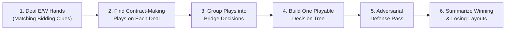

# How the Solver Thinks About Bridge

This guide explains how the Bridge Line Finder works from a card-play
perspective. Standard computer bridge solvers tell you what happens when all 52
cards are face up. This solver answers the question declarer actually faces at
the table: **given only my hand, dummy, and the clues from the auction, what is
the single best plan to make my contract?**

---

## Why Double-Dummy Isn't Bridge

A traditional double-dummy solver (such as Deep Finesse or Bo Haglund's DDS)
solves one layout at a time with all four hands visible. That produces
superhuman plays that no real declarer can find:
- On Deal #1, where East holds a singleton Queen, double-dummy plays the Ace to
  drop it.
- On Deal #2, where East holds Queen-third, double-dummy leads to the Jack to
  finesse.
- If a defender holds a two-way guess, double-dummy always picks the right suit
  to attack.

At the table, you only see 26 cards—North and South—plus whatever you can infer
from the bidding and the cards played so far. You cannot play one way on Deal #1
and a different way on Deal #2 unless **something visible happens during the
play** (such as an honor appearing or a defender showing out of a suit) that
tells you which layout you are in.

Instead of solving each layout in isolation, this solver builds a **single
conditional plan**—a decision tree of tricks and visible branches—that makes
your contract across the largest possible share of hidden East/West layouts.

---

## Overview of a Solve

Every solve runs in six main stages:

1. **Sample unseen hands**: Deal out hundreds of random East/West layouts that
   fit any bidding or play clues.
2. **Solve for the contract**: On each layout, find all plays that still make
   your trick target (including safety plays that give up overtricks).
3. **Generalize defender cards**: Group identical bridge situations together
   ("West follows low" vs. "West covers with an honor" vs. "West shows out").
4. **Build a legal decision tree**: Construct a declarer plan that only branches
   on cards seen at the table.
5. **Test against adversarial defense**: Re-score the top candidate plans
   against defenders who actively choose the toughest legal defense against your
   exact line.
6. **Explain the layouts**: Summarize in plain bridge terms which suit breaks
   and honor locations make or break the plan.

---

## 1. Simulating Possible East/West Layouts

The solver starts with the cards you can see (North and South, plus any cards
already played to earlier tricks) and deals the remaining unseen cards randomly
between East and West, typically 100 to 300 times.

Real bridge hands rarely treat every unseen layout as equally likely. If West
opened a weak two-bid or East overcalled 1NT, you know quite a bit about their
shapes and high cards. Before dealing, the solver lets you attach constraints to
East and West (implemented in [`hand_requirements.h`](../hand_requirements.h)):
- **High Card Points (HCP)**: e.g., East holds 12–14 HCP, or West holds at most
  7 HCP.
- **Suit lengths**: e.g., West has at least 5 spades, or East has 2–3 hearts.
- **Hand pattern**: e.g., a balanced hand, a void, or possession of a specific
  honor like the ♠K.

Every simulated deal is checked against those rules before the play search
begins, so the percentages reflect the auction rather than raw 52-card odds.

---

## 2. Aiming for the Contract, Not Overtricks

When a double-dummy engine analyzes a deal, its default mode asks: *"Which card
wins the maximum possible number of tricks?"* In rubber bridge or IMPs,
maximizing tricks on one layout can actually hurt your chance of making the
contract across all layouts.

Consider a classic safety play in trumps. Cashing the Ace first might hold you
to five trump tricks when the suit breaks 3-2, whereas finessing immediately
wins six trump tricks on a friendly 3-2 split—but goes down when an honor is
singleton offside. If the solver only kept plays that won the *maximum* tricks
on each deal, it would throw away the safety play on every 3-2 deal!

To prevent that, the solver asks DDS a different question on declarer's turn (in
[`interface_dds.cc`](../interface_dds.cc)): **"Which cards still make at least
the contract (`min_tricks`)?"**
- Any play that makes the contract stays alive as a candidate on that deal, even
  if a riskier peek-dependent play could win an overtrick.
- Once the contract is already locked up (`min_tricks <= 0`), the solver
  switches to maximizing the remaining tricks to keep the end-of-hand play
  clean.

---

## 3. How Defenders Play During the Initial Search (Step 1)

On any single deal, double-dummy analysis often reports that several defensive
cards tie. Suppose dummy leads a small card toward **A Q** in South, and East
(sitting in front of South) holds **K 2**. Double-dummy, East's **K** and **2**
tie: South wins both the **A** and the **Q** either way.

If East popped up with the **K** from **K 2** half the time, declarer would
never face a real finesse guess, and the decision tree would learn unnatural
habits based on defense no human plays at the table.

During the initial search (`ChooseDefenderPlay` in
[`interface_dds.cc`](../interface_dds.cc)), whenever multiple cards tie for best
double-dummy defense, defenders break ties using normal human carding rules:
- **Opening lead / 1st hand**: Defenders lead the bottom of touching honors
  (such as the Queen from **Q J 10**), avoid leading away from an unsupported
  honor into declarer's tenace (for instance, refusing to lead from **J x x**
  into **A Q**), and otherwise make a low lead.
- **2nd hand**: Defenders play **2nd hand low**, playing their lowest optimal
  spot card.
- **3rd hand**: Defenders play **3rd hand high** (the cheapest of touching high
  cards), unless partner led an honor (Jack or higher) that is currently winning
  the trick and they have a lower optimal card that avoids overtaking partner.
- **4th hand**: If declarer or dummy is currently winning the trick, 4th hand
  wins as cheaply as possible; if partner is already winning, 4th hand plays low
  unless forced to overtake.
- **Touching honors**: When a defender holds touching equals (like **K Q** or
  **Q J 10**), the solver randomizes uniformly among those touching honors using
  a deterministic seed per board. That stops declarer from inferring that
  "playing the King guarantees the defender does not hold the Queen."
- **Defensive noise**: A small configurable noise setting (default 10%)
  occasionally selects an alternative double-dummy-optimal play so declarer's
  line does not become brittle against slightly unusual but still sound defense.

---

## 4. Grouping Cards into Bridge Decisions

As the solver looks across hundreds of simulated deals, it cannot tell declarer
*"play the ♠2 on Deal #4 and the ♠Q on Deal #9."* Declarer's own plays must be
concrete cards chosen before seeing the next defender's card.

Defender cards, however, vary from deal to deal even in the exact same bridge
situation: on one deal West follows low with the **♠3**, on another with the
**♠5**, and on a third with the **♠8**. To a bridge player, all three mean the
same thing: **West followed with a small spade**.

The solver groups defender plays into bridge categories (`GeneralizeOppCard` and
`GeneralizedTrickFinder` in [`conditional_line.cc`](../conditional_line.cc)):
- **Specific honor** (`SK`, `SQ`, `HJ`): Used when covering, splitting, or
  dropping an honor changes declarer's play.
- **Small spot card** (`Sx`, `Hx`): Any spot card (`2` through `9`) in the suit.
- **Any honor** (`SX`): Any honor (`10` through `A`) in the suit.
- **Any card in the suit** (`S_`): Following suit when the rank does not matter.
- **Discard / show-out** (`R_`): Pitching another suit when void (which tells
  declarer the suit broke badly).
- **Any card at all** (`__`): When declarer's play is unconditional.

By combining declarer's exact card with these defender buckets, the solver turns
hundreds of raw deal records into clear instructions like:
> Lead **♠2** from South. If West plays a small spade (`Sx`), play **♠Q** from
> North; if West puts up the **♠K** (`SK`), win the **♠A** in North.

---

## 5. Building a Single Playable Decision Tree

The heart of the solver (`LineFinder::Solve` in
[`line_finder.cc`](../line_finder.cc)) searches for the decision tree
(`ConditionalLine`) that succeeds on the highest number of simulated layouts.

To keep the line 100% legal at the table, the tree is only allowed to branch on
**information visible to declarer**:
1. **A defender's card during a trick** (`TrickPlayCondition`): Declarer leads
   toward dummy, watches whether Left-Hand Opponent follows low, splits honors,
   or shows out, and then chooses dummy's play.
2. **Who won the trick** (`WinnerPlayCondition`): After a finesse or a hold-up
   play, one branch continues when North or South wins the trick, and another
   branch handles what to do when East or West wins and shifts.
3. **Whether declarer's top card in a suit is now high** (`IsCardGoodCondition`,
   `TryBranchOnGoodCards`): After playing one or two rounds of a suit, a bridge
   player checks whether an opposing honor dropped or the suit split evenly. For
   example, after cashing **♥A** and **♥K**, declarer can see whether dummy's
   **♥J** is now the highest heart left in the deck. If the **♥J** is good,
   declarer cashes it; if an opponent still holds the **♥Q**, declarer switches
   to a ruffing or side-suit plan.

### Avoiding Sample Traps on Rare Branches (Thin-Node Splintering)

Suppose you start with 300 random East/West deals. By Trick 5—after East won
Trick 2 with a specific card and shifted to a diamond—only 8 of the original 300
deals might reach that exact branch of the tree.

With only 8 sample deals left on a branch, a naive search can fall into a
"sample trap": it might find a weird play (like ruffing prematurely instead of
drawing a round of trumps) that happens to survive on 6 of those 8 sample deals
by sheer luck of how the spot cards fell.

When an interior branch gets thin (fewer than 50 deals left out of a large
solve, in `RefineThinNodesOnNode`), the solver performs **thin-node
splintering**:
- For each real deal on that branch, it deals fresh "splinter" East/West layouts
  of the remaining unseen cards.
- Every splinter layout strictly obeys all cards already played, all bidding
  constraints, and **every suit void** East or West has already shown during
  earlier tricks (`shown_out_mask_`), so a splinter hand can never reneg.
- The solver evaluates candidate continuations across both the real deals and
  their splinters, picking the true percentage bridge play rather than
  overfitting to a tiny sample.

---

## 6. The Adversarial Defense Pass (Step 2 Re-scoring)

Solving each deal in Step 1 has one subtle blind spot: in Step 1, the defenders
on Deal #42 do not yet know what decision tree declarer is going to adopt across
all 300 deals.

### Why Step 1 Can Be Too Optimistic

Imagine East wins Trick 1 with the **♣Q**. On Deal #42, East looks at all four
hands double-dummy and sees that returning a **club** or returning a **spade**
both hold declarer to nine tricks if declarer plays double-dummy. So DDS
considers a club return and a spade return tied.

Now suppose declarer's chosen plan across the 300 deals has a weakness:
- When East returns a **club**, declarer's plan makes the contract on 85% of
  layouts.
- When East shifts to a **spade**, declarer's plan is put to an immediate guess
  before trumps are drawn and only makes on 45% of layouts.

Against a real expert defender, East will shift to a spade! If the solver relied
only on Step 1's neutral tie-breaker, it might score Deal #42 as a win because
East happened to return a passive club in Step 1.

### How Step 2 Adversarial Defense Works

Once Step 1 finishes, the solver takes the top candidate decision trees (up to
20 candidate plans) and runs a second, adversarial pass
(`RescoreTopLinesAdversarial` in [`line_finder.cc`](../line_finder.cc) and
`ChooseAdversarialDefenderCard` in
[`conditional_line.cc`](../conditional_line.cc)):

1. **List all double-dummy-optimal defensive cards**: At every defensive turn on
   a deal, DDS finds all cards that do not give away a trick double-dummy
   (`FindOptimalDefenderCards`). Defenders will never intentionally blow a trick
   just to confuse declarer.
2. **Check declarer's branch success rate for each card**: If two or more
   defensive cards tie double-dummy on that deal, the defender looks at
   declarer's decision tree and checks what fraction of deals declarer makes
   down each corresponding branch (`BranchSuccessProbability`).
3. **Include unmakeable deals in the branch odds**: Before scoring, the solver
   also traces deals that were unmakeable from the start or became unmakeable
   after an earlier play (`TraceUnmakeableBoard`). Including those losing
   layouts in each branch's denominator prevents a risky switch from looking
   like a "100% declarer branch" just because Step 1 had already dropped the
   layouts where that switch beat the contract.
4. **Pick the toughest defense**: The defender plays the double-dummy-optimal
   card that **minimizes** declarer's success rate on that branch.
5. **Re-rank declarer's plans**: Every candidate line is re-scored by how many
   deals it actually makes against this tough defense, and the plan that
   survives the most deals wins.

In bridge terms, Step 1 finds promising declarer plans against normal defense,
and Step 2 stress-tests those plans against defenders who know how to find the
killing shift or deceptive honor split whenever it costs them nothing
double-dummy.

---

## 7. Explaining When a Plan Wins or Fails

Knowing that a line works on 76% of simulated layouts is useful, but a bridge
player also wants to know *why* it works on those 76% and *what goes wrong* on
the other 24%.

After choosing the top line, the solver inspects the East/West hands on all
winning deals and all losing deals (`CrossHandDealSetSummarizer` in
[`cross_hand_summarizer.h`](../cross_hand_summarizer.h) and
[`unknown_cards_invariant.h`](../unknown_cards_invariant.h)) and extracts
human-readable rules:
- **Suit splits**: e.g., *"Spades break 3-2"* or *"Neither defender holds more
  than 4 clubs."*
- **Honor locations**: e.g., *"West holds the ♥K"* or *"East holds at least one
  diamond honor."*
- **Compound conditions**: e.g., *"Either hearts are 3-3, or the defender with
  4+ hearts also holds the ♠Q"*—the exact condition for a trump-and-spade
  squeeze or a drop-else-finesse line.

To keep the summary clean, the solver tests candidate rules against random
splits of the unseen cards (`FilterUninterestingInvariants`) and filters out
trivial statements that are true on almost every deal anyway. What remains is a
concise bridge explanation of the layouts your line beats and the layouts that
defeat it.

---

## Quick Reference: Bridge Concepts in the Code

| Bridge Concept | Where It Lives | Key Function / Class |
| :--- | :--- | :--- |
| Bidding clues (HCP, length, shape) | [`hand_requirements.h`](../hand_requirements.h) | `HandRequirements`, `HighCardRange`, `SuitLength` |
| Dealing unseen E/W hands | [`line_finder.h`](../line_finder.h), [`deal.cc`](../deal.cc) | `FuzzyBoardState::Randomize`, `DealMissingCards` |
| Solving for contract vs. overtricks | [`interface_dds.cc`](../interface_dds.cc) | `DDSSolveHelper` (`use_min_tricks_target`) |
| Human defensive leads & carding | [`interface_dds.cc`](../interface_dds.cc) | `ChooseDefenderPlay`, `RandomizeTouchingHonorRank` |
| Grouping spot cards, honors, show-outs | [`conditional_line.cc`](../conditional_line.cc) | `GeneralizeOppCard`, `GeneralizedTrickFinder` |
| Checking if a card is now high | [`conditional_line.cc`](../conditional_line.cc), [`line_finder.cc`](../line_finder.cc) | `IsCardGoodCondition`, `LineFinder::TryBranchOnGoodCards` |
| Thin-branch resampling without renegs | [`line_finder.cc`](../line_finder.cc), [`board_state.h`](../board_state.h) | `RefineThinNodesOnNode`, `BoardState::shown_out_mask_` |
| Adversarial defense re-scoring (Step 2) | [`line_finder.cc`](../line_finder.cc), [`conditional_line.cc`](../conditional_line.cc) | `RescoreTopLinesAdversarial`, `ChooseAdversarialDefenderCard` |
| Counting unmakeable layouts on branches | [`conditional_line.cc`](../conditional_line.cc) | `TraceUnmakeableBoard`, `BranchSuccessProbability` |
| Summarizing winning & losing layouts | [`cross_hand_summarizer.cc`](../cross_hand_summarizer.cc) | `CrossHandDealSetSummarizer::Summarize` |
