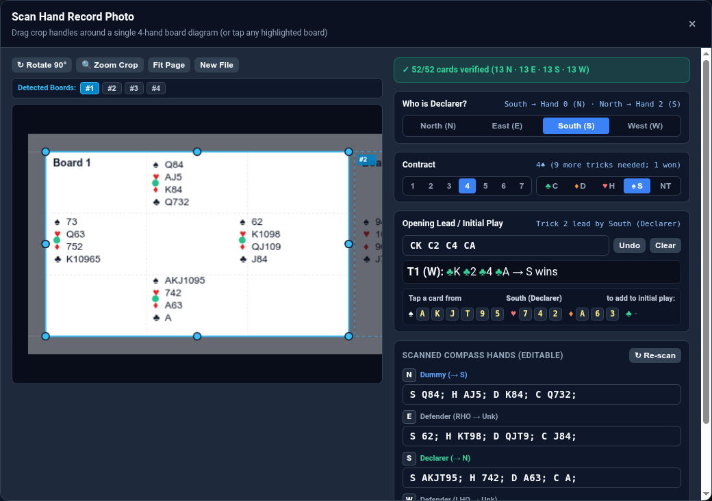
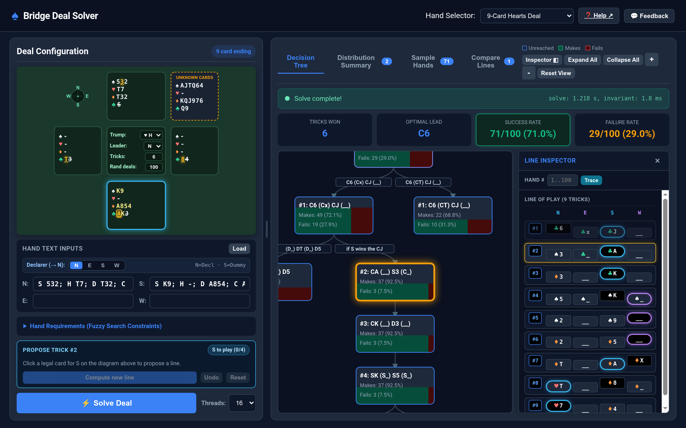
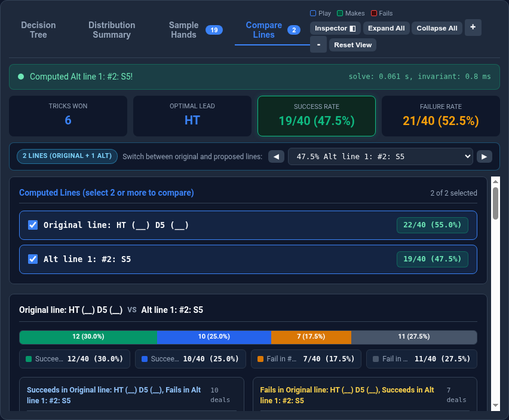
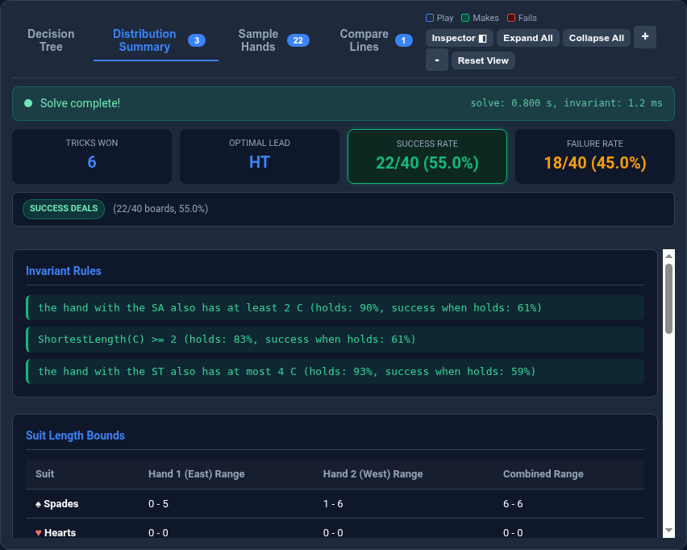

# Bridge Deal Solver User Guide

Welcome to the **Bridge Deal Solver & Decision Tree Explorer**. This guide walks
through how to load deals from hand records or files, explore the interactive
decision tree, test your own lines of play, and compare competing strategies.

---

## 1. Loading Hands & Setting Up a Deal

You can start from a built-in classic problem, scan a tournament hand record
(PDF, photo, or PBN), import a text deal file, or type cards directly.

### Built-In Presets & Session History

Use the **Hand Selector** dropdown in the top header to load built-in deals
such as *Simple Finesse*, *4-Card Endplay*, *Squeeze Deal (NT)*, *9-Card
Hearts*, *Safety Play*, *Restricted Choice*, *Mollo 6S*, or *2-Way Finesse*.

Whenever you load a board from a PDF, photo, PBN, or text file during your
session, it is automatically added to the **Hand Selector** dropdown (for
example, `Hand 14 from club_game.pdf`) so you can switch back to it at any
time.

### The `Load` Button: PDFs, Photos, PBNs & Text Files

Click **Load** in the **Hand Text Inputs** header to import a deal from your
device:

1. **PDF Hand Records (`.pdf`)**
   - Supports multi-page tournament hand record sheets (such as ACBL/Common
     Game PDFs).
   - If the PDF contains embedded PBN deal records, all boards are extracted
     instantly; the visual PDF page is also rendered so you can browse pages
     with **`◀ Page 1 / N ▶`** and click any detected board pill (**`#1`**,
     **`#2`**, ..., **`#16`**) or tap a board diagram directly on the page.
2. **Camera Photos & Screenshots (`.png`, `.jpg`, `.webp`, etc.)**
   - Runs **on-device optical character recognition (OCR)** directly in your
     browser.
   - Automatically detects all 4-hand compass diagrams in the image. Drag the
     crop handles around any board, use **`↻ Rotate 90°`** or **`🔍 Zoom
     Crop`**, and edit any scanned suit holding if needed before applying.
3. **Portable Bridge Notation Files (`.pbn`)**
   - Parses all `[Deal "..."]` records (along with `[Board "..."]`,
     `[Declarer "..."]`, and `[Contract "..."]` tags when present) and renders
     an interactive multi-board sheet in the scanner modal.
4. **Plain-Text Deal Files (`.txt`, `.deal`)**
   - Supports key-value files (`north = S AQ...`, `south = ...`,
     `unknown_cards = ...`, `trump = SPADES`, `leader = EAST`, `target = 10`,
     `iters = 100`, `declarer = S`, `cur_trick = ...`) as well as 4-line
     plain-text files (North, East, South, West on consecutive lines).

After loading a PDF, photo, or PBN, a **Crop Photo** button appears next to
**Load** so you can re-open the board sheet and pick another board or adjust
the settings without re-uploading the file.

### Scanner Modal: Declarer Rotation, Contract & Opening Lead

When you load a 4-hand board in the scanner modal, you can configure the table
context before clicking **Apply to Deal**:

- **Who is Declarer? (`N`, `E`, `S`, `W`)**: The solver always normalizes the
  table so **Declarer sits at North** and **Dummy sits at South**. Selecting
  who declared the hand at the table automatically rotates the four hands so
  Declarer becomes North and Dummy becomes South, pools the two defenders'
  cards into **Unknown Cards**, and saves the real East/West layout as
  **Actual Deal (`#0`)**. You can also rotate Declarer at any time from the
  main **`Declarer (→ N)`** bar.
- **Contract (`1`–`7`, `♣`/`♦`/`♥`/`♠`/`NT`)**: Sets the trump strain and
  automatically computes the required tricks (`6 + level`).
- **Opening Lead / Initial Play**: Type or tap cards played at the start of the
  deal (for example, the opening lead `DQ`, or the first trick `DQ D2 DA DK`
  followed by a shift `S7`). Completed tricks automatically adjust the target
  tricks and next leader, partial tricks pre-populate the current trick on the
  table, and any defender show-out automatically records a void constraint for
  that defender.

### Manual Deal Configuration & Constraints

- **Single-Dummy vs. Double-Dummy**:
  - For **single-dummy** analysis (realistic declarer play), put Declarer's
    hand in **N**, Dummy's hand in **S**, leave **E** and **W** empty (or only
    enter known cards), and list the remaining unseen cards in **Unknown Cards
    (Defender Pool)** under *Hand Requirements*. You can use specific ranks
    (`S KJT9`) or `x` for indistinguishable small spot cards (`S Kxxx`).
  - For **double-dummy** analysis (all 4 hands visible), fill in **N**, **E**,
    **S**, and **W** and leave **Unknown Cards** empty.
- **Center Table Controls**: Set **Trump** (`♠`, `♥`, `♦`, `♣`, `NT`),
  **Leader** (`N`, `E`, `S`, `W`), **Tricks** (target tricks for N/S), and
  **Rand deals** (number of random East/West layouts to sample).
- **Hand Requirements (Fuzzy Search Constraints)**: Expand *Hand Requirements*
  to restrict **West** or **East** by **HCP Range** (Min–Max) or minimum suit
  lengths when the auction gives you inferences about the defenders' hands.

---

## 2. Exploring the Decision Tree & Line Inspector

Clicking **⚡ Solve Deal** computes declarer's optimal conditional play tree and
displays it in the **Decision Tree** tab.

### Reading Nodes, Colors & Edge Conditions

Each card in the tree represents a trick or final outcome:

- **Node Fill Proportions (`Makes` / `Fails` / `Unreached`)**: Each node's
  vertical fill shows how common that branch is across all sampled deals: if a
  node is reached by 25% of total deals, the top 75% is shaded grey while the
  bottom 25% is split left-to-right between **green** (deals that make) and
  **red** (deals that go on to fail).
- **Green Leaf Nodes (`Makes`)**: The contract succeeds on all deals reaching
  this leaf (`N/S Won: X`).
- **Red Leaf Nodes (`Fails`)**: The defense defeats the line on the deals
  reaching this leaf.
- **Edge Condition Badges**: Arrows between tricks show *why* the play branches
  —such as `if E plays SQ`, `when W wins SK`, or `when E discards`.
- **Card Wildcard Notation**: When the specific spot card doesn't change the
  strategy, the tree groups cards using shorthand:
  - `Sx`: Any low spot card (`2`–`9`) in spades.
  - `SX`: Any honor (`T`, `J`, `Q`, `K`, `A`) in spades.
  - `S_`: Any spade of any rank.
  - `R_`: Any discard or ruff in another suit.

### What Happens When You Click Around the Tree

- **Clicking Any Node**:
  1. Expands the path from the root to the clicked node and continues down its
     primary continuation to a leaf, while collapsing other branches to keep
     the view clean.
  2. Smoothly centers the clicked node in the tree viewport.
  3. Opens the **Line Inspector** side panel on the right with the complete
     trick-by-trick sequence and highlights the clicked trick.
  4. Updates the **Deal Configuration** SVG diagram on the left to show the
     exact board state at that trick and opens the **Propose Trick** bar.
- **Panning & Zooming**: Drag the tree background to pan, scroll/pinch or use
  **`+`** / **`-`** / **`Reset View`** to zoom, and use **`Expand All`** or
  **`Collapse All`** to open or fold the entire tree. Drag the vertical divider
  between the left and right panels to resize them.

### Using the Line Inspector & Diagram Sync

The **Line Inspector** lists every trick along the currently inspected path in
fixed **N / E / S / W** columns:

- The **led card** has a highlighted border, and the **winning card** is badged
  in green (if won by N/S) or red/amber (if won by E/W).
- **Clicking a Trick Row (or `#K` badge)** in the Inspector selects that trick:
  - Earlier tricks' cards (`1..K-1`) are shown **dimmed and struck through** on
    the left SVG deal diagram, while the cards played in Trick `#K` are
    **highlighted in amber** (with a gold box around the led card) and any
    defender cards from **UNKNOWN CARDS** are moved into East's and West's hands
    respectively.
  - Clicking the selected trick row a second time clears the selection and
    restores the full starting hands.

### Tracing a Specific Hand (`Hand #`)

At the top of the Line Inspector, enter a deal number in **`Hand #`** (`1..N`,
or `0` when an Actual Deal from a hand record is loaded) and click **Trace**:

- The exact path taken by that deal through the decision tree is highlighted in
  **glowing cyan**.
- A **Traced Hand Banner** at the top of the Inspector displays West's and
  East's exact 4-suit holdings and whether the deal **MAKES** or **FAILS**.
- Every generalized wildcard in the trick list is replaced with the **actual
  cards** played on that specific deal, and the left SVG diagram displays East
  and West's concrete hands.
- Click **Clear** to exit trace mode and return to the aggregate tree view.

---

## 3. Trying & Comparing Alternative Lines

Bridge players constantly ask *"What if I cash the Ace first?"* or *"What if I
play clubs before drawing the last trump?"* The solver lets you test any line of
play against the exact same random deals and compare them head-to-head.

### Cycling Through Equivalent Optimal Lines

When two or more different lines of play tie for the highest success rate, the
**Multiple Equivalent Lines** bar appears above the tree. Use the **`◀`** /
**`▶`** buttons or the dropdown menu to switch between them.

### Proposing an Alternative Line (`Propose Trick #K`)

You can branch off and force your own play at any trick:

1. **Select a Trick**: Click a node in the Decision Tree or click any trick row
   `#K` in the **Line Inspector**.
2. **Pick Cards on the Deal Diagram**:
   - The **Propose Trick #K** bar appears in the left panel showing whose turn
     it is to play (`N to play (0/4)`, `E to play (1/4)`, etc.).
   - Legal cards for the active player glow **bright yellow** on the SVG deal
     diagram (for defenders in a single-dummy solve, click cards directly in the
     **UNKNOWN CARDS** box).
   - You can click **1 card** (for example, forcing declarer's lead to the trick
     and letting the solver handle the defenders' replies) or up to **all 4
     cards** of the trick.
3. **Compute the Continuation**: Click **Compute new line** (or use **Undo** to
   step back one card, or **Reset** to return to the original solve).
   - The solver replays Tricks `1..K-1`, forces your proposed card(s) at Trick
     `#K`, and solves the remainder of the deal across the **exact same sampled
     deals** (`reuse_deals`).
   - If a defender shows out on a proposed trick, the solver automatically
     constrains that defender to be void in the led suit for the continuation.
   - Your new line is added to the line selector dropdown as
     **`Alt line 1: Trick #K ...`** with its overall success percentage, so you
     can switch freely between the **Original line** and every **Alt line** you
     have explored.

### Comparing Lines Head-to-Head (`Compare Lines` Tab)

Once you have multiple lines (either multiple optimal lines from the initial
solve or one or more proposed **Alt lines**), click the **Compare Lines** tab:

1. **Select Lines**: Check the boxes next to **2 or more lines** in the
   *Computed Lines* list.
2. **Stacked Bar Breakdown**: For each pair of selected lines (**Line A vs. Line
   B**), a color-coded bar chart breaks all sampled deals into four buckets:
   - **Both Make (Green)**: Deals where either line succeeds.
   - **Only Line A Makes (Blue)**: Deals where Line A succeeds and Line B fails.
   - **Only Line B Makes (Amber)**: Deals where Line B succeeds and Line A
     fails.
   - **Both Fail (Slate)**: Unmakeable layouts where neither line succeeds.
3. **Inspect Disagreement Deals**: Below the chart, side-by-side columns list
   the specific sample deals where **Only Line A Makes** vs. **Only Line B
   Makes**. Click any deal card to immediately switch to that line and trace
   that exact hand in the **Decision Tree**!

---

## 4. Distribution Summaries, Sample Hands & Actual Deal (`#0`)

Above the main tabs, the **Result Summary Cards** show **Tricks Won**, **Optimal
Lead** (or **Card Led**), **Success Rate**, **Failure Rate**, and—when loaded
from a 4-hand record—**Actual (`#0`)**.

### Filtering by Success, Failure, or Actual Deal (`#0`)

The **Success Rate**, **Failure Rate**, and **Actual (`#0`)** stat cards are
interactive toggle buttons:

- Click **Success Rate** to inspect the layouts where declarer's line **makes**
  the contract.
- Click **Failure Rate** to inspect the layouts where the defense **beats** the
  contract.
- Click **Actual (`#0`)** (when present) to isolate and trace the real table
  layout from your loaded hand record.

### The `Distribution Summary` Tab

The **Distribution Summary** tab translates the raw set of making (or failing)
deals into bridge table takeaways:

- **Invariant Rules**: Automatically discovered rules that hold true across the
  selected deals—such as *"East holds the King of Spades"*, *"Hearts split
  3-2"*, or *"West has at most 1 diamond"*.
- **Suit Length Bounds**: Minimum and maximum suit lengths for East, West, and
  their combined holding.
- **Honor Card Possession Stats**: The exact percentage of deals in which East,
  West, both, or neither holds each key honor (`A`, `K`, `Q`, `J`, `T`).

### The `Sample Hands` Tab

The **Sample Hands** tab displays miniature 4-hand compass diagrams for the
sampled deals (`#1..#N`, plus `#0 Actual` when available) matching your active
filter (**Covered Deals**, **Non-Covered Deals**, or **Actual Deal `#0`**):

- Each card shows the board number (`#1`, `#2`, ...) and full 4-hand layout.
- **Click any sample deal card** to jump straight to the **Decision Tree** tab
  with that hand traced from Trick 1 to the end of play.
