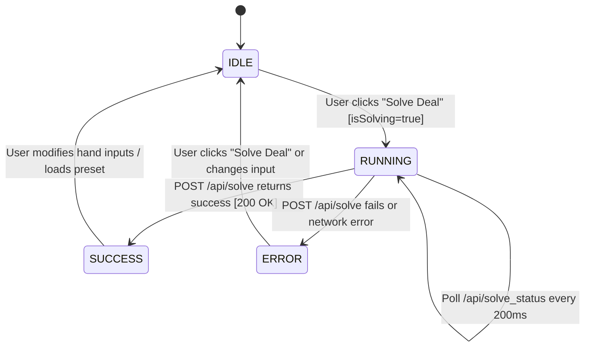
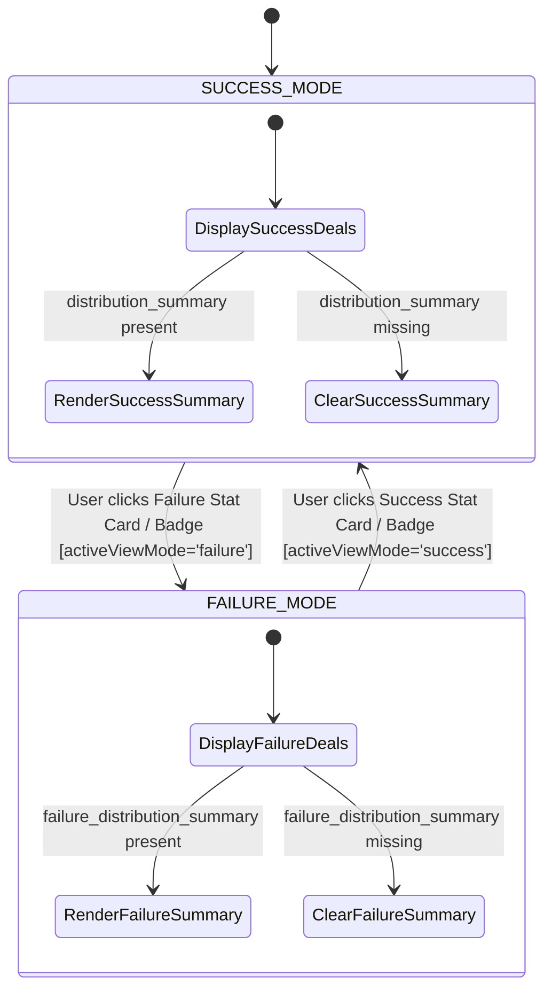
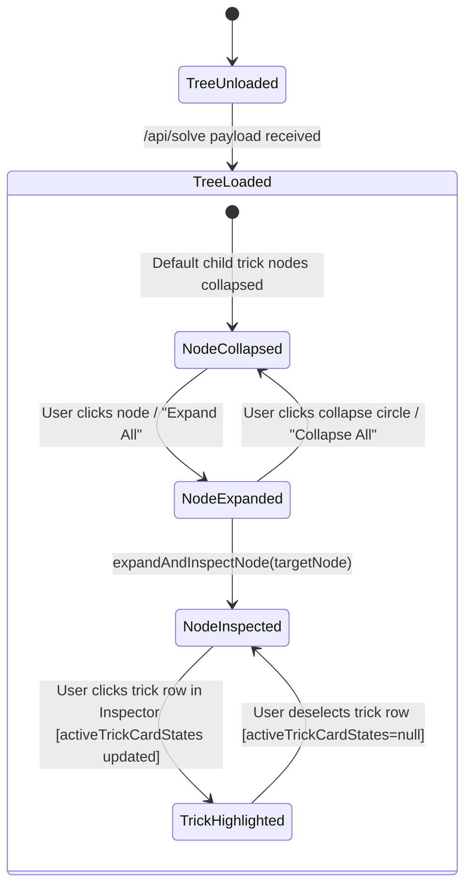
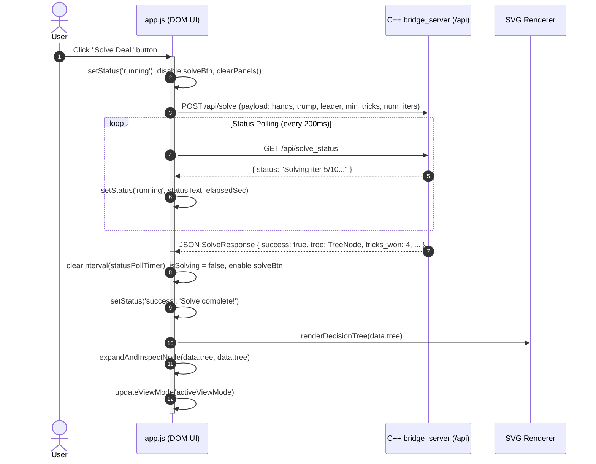
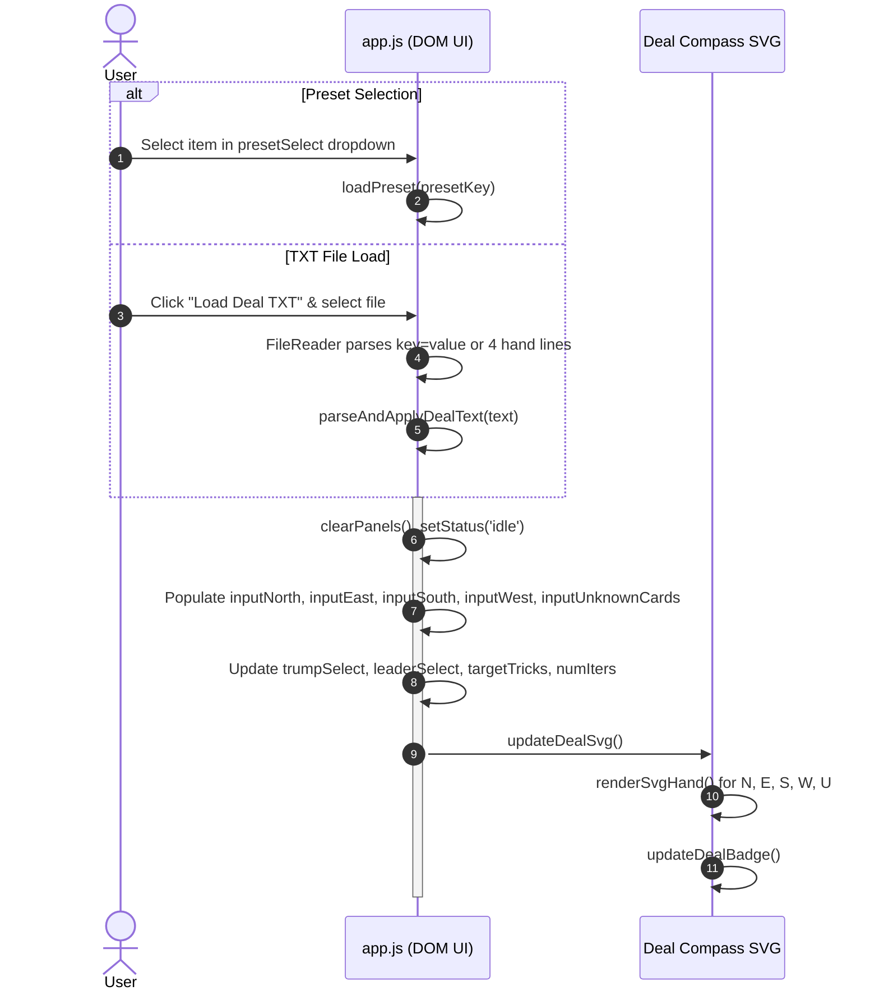
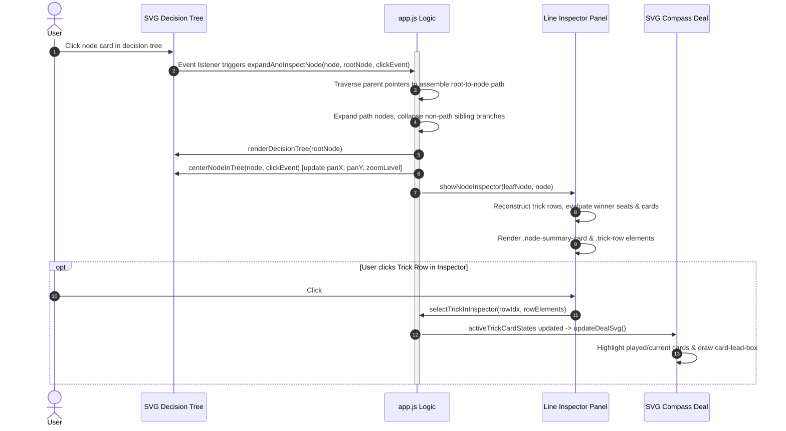
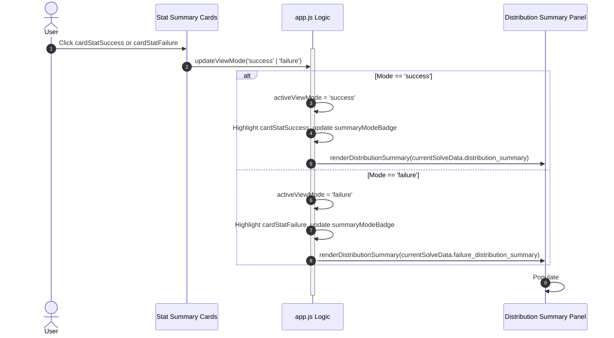

# Web Frontend Architecture & Client State Machine Specification

This document provides the formal architectural specification, state transition rules, event dispatch lifecycles, and DOM/SVG rendering data contracts for the interactive Single-Page Application (SPA) in `web/static/app.js`.

---

## Table of Contents

1. [Overview & Architecture Principles](#1-overview--architecture-principles)
2. [Client State Machine & State Variables](#2-client-state-machine--state-variables)
   - [State Constants & Enums](#state-constants--enums)
   - [Complete Client State Variable Dictionary](#complete-client-state-variable-dictionary)
   - [State Transition Diagrams](#state-transition-diagrams)
3. [Event Dispatch Lifecycles & Sequence Diagrams](#3-event-dispatch-lifecycles--sequence-diagrams)
   - [Deal Solve & Polling Lifecycle](#deal-solve--polling-lifecycle)
   - [Preset & File Loading Sequence](#preset--file-loading-sequence)
   - [Node Inspection & Viewport Centering Sequence](#node-inspection--viewport-centering-sequence)
   - [Distribution View Mode Toggle Sequence](#distribution-view-mode-toggle-sequence)
4. [DOM & SVG Data Contracts](#4-dom--svg-data-contracts)
   - [SVG Decision Tree Contract](#svg-decision-tree-contract)
   - [SVG Deal Compass Diagram Contract](#svg-deal-compass-diagram-contract)
   - [Line Inspector DOM Contract](#line-inspector-dom-contract)
   - [Distribution Summary DOM Contract](#distribution-summary-dom-contract)
5. [Backend API Contract Alignment](#5-backend-api-contract-alignment)

---

## 1. Overview & Architecture Principles

The web frontend of the Bridge Decision Engine is implemented as a lightweight, zero-dependency Single-Page Application (SPA) contained in `web/static/app.js`, `index.html`, and `styles.css`.

### Key Architecture Constraints & Principles

1. **Zero External Build Runtime Dependencies**: Native vanilla JavaScript ES6 execution without Node.js, Webpack, Babel, or external JS frameworks.
2. **Embedded Asset Pipeline**: Frontend static assets in `web/static/` are compiled directly into C++ header `web/web_assets.h` using `python3 web/generate_web_assets.py`.
3. **Reactive Vector Rendering**: Dynamic decision tree structures and deal cards are rendered using native browser SVG APIs (`document.createElementNS('http://www.w3.org/2000/svg', ...)`).
4. **Explicit Contract Safeguards**: In-code type enforcement via JSDoc type definitions (`@typedef`) and immutable state constant enums (`SolveStatus`, `ViewMode`, `CardState`, `AppState`, `SeatDirection`, `TrumpSuit`).

---

## 2. Client State Machine & State Variables

### State Constants & Enums

The application defines standardized state constant objects in `web/static/app.js`:

```javascript
/** @enum {string} */
const SolveStatus = Object.freeze({
  IDLE: 'idle',
  RUNNING: 'running',
  SUCCESS: 'success',
  ERROR: 'error'
});

/** @enum {string} */
const ViewMode = Object.freeze({
  SUCCESS: 'success',
  FAILURE: 'failure'
});

/** @enum {string} */
const CardState = Object.freeze({
  NORMAL: 'normal',
  PLAYED: 'played',
  CURRENT: 'current'
});

/** @enum {string} */
const AppState = Object.freeze({
  SETUP: 'setup',
  SOLVING: 'solving',
  EXPLORING: 'exploring',
  INSPECTING: 'inspecting'
});

/** @enum {string} */
const SeatDirection = Object.freeze({
  NORTH: 'N',
  EAST: 'E',
  SOUTH: 'S',
  WEST: 'W',
  UNKNOWN: 'U'
});

/** @enum {string} */
const TrumpSuit = Object.freeze({
  SPADES: 'SPADES',
  HEARTS: 'HEARTS',
  DIAMONDS: 'DIAMONDS',
  CLUBS: 'CLUBS',
  NOTRUMP: 'NOTRUMP'
});
```

---

### Complete Client State Variable Dictionary

All 100% of client runtime state variables managed in `web/static/app.js` are documented below:

| Variable Name | Type | Default / Initial Value | Description | Valid State Range & Transitions |
| :--- | :--- | :--- | :--- | :--- |
| `zoomLevel` | `number` | `1.0` | Zoom scale factor applied to tree root SVG group `#treeRootGroup`. | Range: `[0.3, 3.0]`. Mutated by zoom buttons, wheel event, or viewport reset. |
| `panX` | `number` | `40` | X-axis pixel offset for tree SVG viewport panning. | Integer/float. Mutated by mouse drag, node centering, or view reset. |
| `panY` | `number` | `40` | Y-axis pixel offset for tree SVG viewport panning. | Integer/float. Mutated by mouse drag, node centering, or view reset. |
| `isDragging` | `boolean` | `false` | Viewport mouse drag tracking flag. | `false` $\rightarrow$ `true` on `mousedown` on `#treeViewport`; `true` $\rightarrow$ `false` on `mouseup`. |
| `startX` | `number` | `0` | Reference X mouse coordinate recorded at drag start. | X screen coordinate pixel offset. |
| `startY` | `number` | `0` | Reference Y mouse coordinate recorded at drag start. | Y screen coordinate pixel offset. |
| `currentTreeData` | `TreeNode\|null` | `null` | Root node object of the active decision tree structure. | `null` $\rightarrow$ `TreeNode` on API solve success or preset load clear. |
| `currentSolveData` | `SolveResponse\|null` | `null` | Full JSON API response payload returned by `/api/solve`. | `null` $\rightarrow$ `SolveResponse` on solve completion; cleared on preset/input reset. |
| `currentCenteredNode` | `TreeNode\|null` | `null` | Reference to currently focused/highlighted decision tree node. | `null` or `TreeNode` instance. Updated during node expand/inspect or trick click. |
| `activeViewMode` | `ViewMode` | `'success'` | Active distribution summary view filter mode (`'success'` vs `'failure'`). | Enum: `'success'` $\leftrightarrow$ `'failure'`. Transitioned by clicking stat badges. |
| `activeTrickCardStates` | `Object\|null` | `null` | Per-seat card play status map for highlighting trick state on SVG deal. | Structure: `{ N, E, S, W, U }` mapped to `{ played: CardToken[], current: CardToken[] }`. |
| `PRESETS` | `Object<string, DealPreset>` | Embedded Default | Map of pre-configured deal preset specifications. | Loaded via `fetch('/api/presets')` on initialization or default fallbacks. |
| `isResizing` | `boolean` | `false` | Panel resizer drag active flag. | `false` $\rightarrow$ `true` on resizer `mousedown`/`touchstart`; `true` $\rightarrow$ `false` on pointer up. |
| `resizeStartX` | `number` | `0` | Reference screen X coordinate when split panel resizing starts. | Pointer X position in pixels. |
| `resizeStartWidth` | `number` | `0` | Width of `.deal-setup-panel` at resize start. | Pixel width of panel. |
| `isSolving` | `boolean` | `false` | Active asynchronous solve request indicator flag. | `false` $\rightarrow$ `true` on Solve button click; `true` $\rightarrow$ `false` on POST response/error. |
| `statusPollTimer` | `number\|Timer\|null` | `null` | Interval timer handle for polling `/api/solve_status`. | Handle integer or `null`. Set during async solve, cleared on solve completion/error. |

---

### State Transition Diagrams

#### 1. Solver Execution State Machine



#### 2. View Mode & Distribution Summary State Machine



#### 3. Decision Tree Node Expansion & Line Inspection State Machine



---

## 3. Event Dispatch Lifecycles & Sequence Diagrams

### Deal Solve & Polling Lifecycle



---

### Preset & File Loading Sequence



---

### Node Inspection & Viewport Centering Sequence



---

### Distribution View Mode Toggle Sequence



---

## 4. DOM & SVG Data Contracts

### SVG Decision Tree Contract

The decision tree canvas renders interactive SVG elements under `#treeRootGroup` inside `#treeSvg`:

```html
<!-- Decision Tree Link Connection -->
<path class="tree-link" d="M 120 78 C 120 109, 200 109, 200 140" marker-end="url(#arrow)" />

<!-- Conditional Edge Badge -->
<g class="tree-edge-label-group">
  <rect x="130" y="100" width="60" height="18" rx="4" class="tree-edge-label-bg" />
  <text x="160" y="113" text-anchor="middle" class="tree-edge-label">S A wins</text>
</g>

<!-- Decision Node Card -->
<g transform="translate(100, 140)" style="cursor: pointer;">
  <rect width="240" height="78" class="node-card node-action centered-node" />
  <text x="12" y="22" class="node-text-title">Trick 1: SA SK SQ SJ</text>
  <text x="12" y="42" class="node-text-detail">ACTION | Deals: 10 (100%)</text>
  <circle cx="224" cy="16" r="8" fill="#334155" />
  <text x="224" y="20" text-anchor="middle" fill="#ffffff" font-size="10" font-weight="bold">−</text>
</g>
```

#### Node CSS Class Contracts
- `.node-action`: Standard play trick action nodes.
- `.node-condition`: Branch condition nodes.
- `.node-outcome`: Leaf contract outcome nodes.
- `.centered-node`: Gold border (`#f59e0b`, `stroke-width: 2.5px`) highlighting currently selected/inspected node.

---

### SVG Deal Compass Diagram Contract

Hand holdings in the four compass directions and unknown cards pool are updated dynamically in `#cardsNorthGroup`, `#cardsEastGroup`, `#cardsSouthGroup`, `#cardsWestGroup`, `#cardsUnknownGroup`:

```html
<g id="cardsNorthGroup">
  <text x="0" y="13">
    <tspan class="card-suit-label card-suit-s">♠ </tspan>
    <tspan class="card-values card-rank-played">A</tspan>
    <tspan class="card-values card-rank-current card-rank-lead">K</tspan>
  </text>
  <!-- Highlight box drawn around currently led card token -->
  <rect x="22.5" y="2.5" width="12.0" height="15.0" class="card-lead-box" />
</g>
```

#### Card Rank CSS State Contracts
- `.card-rank-played`: Darkened muted rank text (`#64748b`, line-through) for cards played in past tricks.
- `.card-rank-current`: Bright highlighted rank text (`#38bdf8`, bold) for cards played in active trick.
- `.card-rank-lead`: Led card in active trick, framed by SVG `<rect class="card-lead-box">`.

---

### Line Inspector DOM Contract

The right side inspector panel (`#treeInspectorPanel`) renders trick-by-trick card play rows inside `#inspectorContent`:

```html
<div class="node-summary-card">
  <div class="node-summary-title">Node #node_2 (ACTION)</div>
  <div class="node-summary-detail">Label: "Trick 1: SA SK SQ SJ"</div>
  <div class="node-summary-detail">Deals: 10 (100%) | N/S Won: 4</div>
</div>

<div class="trick-section-header">Line of Play (4 Tricks)</div>
<div class="trick-list">
  <div class="trick-row trick-row-selected" title="Click to highlight Trick 1 cards on deal diagram">
    <div class="trick-row-meta">
      <span class="trick-label clickable">#1</span>
      <span class="seat-badge seat-badge-ns">(N)</span>
    </div>
    <div class="card-chips-row">
      <span class="card-chip card-suit-s card-winner card-winner-ns" title="Played by N (Winner)">
        <span class="suit-symbol">♠</span><span class="card-rank">A</span>
      </span>
      <span class="card-chip card-suit-s" title="Played by E">
        <span class="suit-symbol">♠</span><span class="card-rank">K</span>
      </span>
    </div>
  </div>
</div>
```

---

### Distribution Summary DOM Contract

Distribution summaries for fuzzy deal solves render cross-hand invariant suit rules, length bounds, and honor statistics in `#panelDistributionSummary`:

- `#ruleCounterBadge`: Unread rule count badge (`.badge-counter`).
- `#summaryRulesList`: `<ul>` list of invariant conditional rules formatted as `"The hand with X also has Y"`.
- `#summaryBoundsTable`: Table mapping Spade, Heart, Diamond, Club suit length bounds (`min_hand1`, `max_hand1`, `min_hand2`, `max_hand2`, `min_combined`, `max_combined`).
- `#summaryHonorTable`: Table mapping honor card possession percentages across East (`hand1`), West (`hand2`), Both, and Neither.

---

## 5. Backend API Contract Alignment

JavaScript `@typedef` specifications in `web/static/app.js` align strictly with C++ JSON serializations in `web/web_server.cc`:

| JavaScript JSDoc Type | C++ Struct / JSON Source | REST Endpoint |
| :--- | :--- | :--- |
| `SolvePayload` | `SolveRequest` | `POST /api/solve` |
| `SolveResponse` | `SolveResponseJSON` | `POST /api/solve` |
| `TreeNode` | `DecisionTreeNode` | `POST /api/solve` (`tree` field) |
| `DistributionSummary` | `CrossHandSummaryReport` | `POST /api/solve` (`distribution_summary` field) |
| `SolveStatusResponse` | `SolveStatusJSON` | `GET /api/solve_status` |
| `DealPreset` | `PresetJSON` | `GET /api/presets` / `presets.json` |

